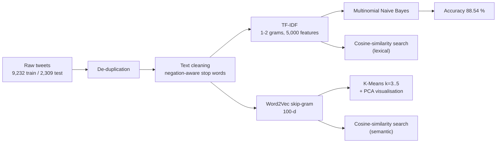

# ✈️ US Airline Tweet Intelligence

### Sentiment Classification, Complaint Clustering and Semantic Search on 11,500+ Airline Tweets


> Airlines receive thousands of public complaints and compliments every day. This project turns that unstructured stream of tweets into three things a customer-experience team can act on: **an automatic sentiment signal**, **recurring complaint themes**, and **a search tool that finds similar past cases in seconds**.

---

## 📌 Executive Summary

| | |
|---|---|
| **Business problem** | Customer-experience teams cannot read every tweet. Which ones are complaints, what are they about, and has this issue been seen before? |
| **Approach** | A classical NLP pipeline: negation-aware text cleaning, TF-IDF with Multinomial Naive Bayes for sentiment, Word2Vec with K-Means for complaint themes, and two retrieval engines (TF-IDF and Word2Vec) for similar-case search |
| **Headline result** | **88.54 % test accuracy** (2,040 of 2,304 unseen tweets classified correctly) with a model that trains in well under a second |
| **Why it is useful** | A fast, interpretable and cheap baseline that can triage incoming tweets, surface complaint topics and retrieve comparable past cases |
| **What makes this write-up different** | It includes a transparent audit of the notebook's own weaknesses and a prioritised fix list (see [Honest Audit](#-honest-audit-known-limitations-and-fixes)) |

---

## 📊 Results at a Glance

| Metric | Value |
|---|---|
| Labelled tweets (train / test) | 9,232 / 2,309 |
| After removing exact duplicates (train / test) | 9,134 / 2,304 (98 and 5 duplicates removed) |
| TF-IDF vocabulary | 5,000 features, unigrams and bigrams |
| **Test accuracy** (MultinomialNB) | **88.54 %** (2,040 / 2,304) |
| Test macro precision | 91.32 % |
| Negative tweets used for theme discovery | 7,287 (79.8 % of the training set) |
| Word2Vec embeddings | 100-dimensional, skip-gram, window 5 |
| Cluster counts explored | k = 3, 4 and 5 |

> **How to read these numbers.** Accuracy is the headline metric. Macro precision is reported separately and should not be read as accuracy. About 80 % of training tweets are negative, so a trivial "always negative" predictor would already score close to 80 % on a similarly distributed test set. The 88.54 % is therefore a solid but not extraordinary baseline. Recall, F1 and a confusion matrix are listed in the roadmap.

---

## 🧭 Pipeline



---

## 🔬 What the Notebook Does

| # | Stage | Details |
|---|---|---|
| 1 | **Data loading** | Pre-split train and test CSVs (`text`, `airline`, `label`) loaded directly from a hosted URL. Label `0` is negative, label `1` is positive. |
| 2 | **De-duplication** | Duplicates removed on `text` + `airline` + `label`. |
| 3 | **Text cleaning** | Lower-casing, punctuation and URL removal, removal of tokens containing digits, HTML stripping, and stop-word removal using a **custom list that deliberately keeps negations and intensifiers** (`not`, `no`, `never`, `very`, `too`, …) so that "not acceptable" is not reduced to "acceptable". |
| 4 | **TF-IDF + Naive Bayes** | `TfidfVectorizer(ngram_range=(1,2), max_features=5000)` fitted on training data only (no leakage into the test set), then `MultinomialNB`. |
| 5 | **Word2Vec** | Skip-gram model trained on the negative tweets; tweets represented as the mean of their word vectors. |
| 6 | **K-Means clustering** | k = 3, 4, 5 on the 7,287 negative-tweet vectors, visualised in 2-D with PCA. |
| 7 | **TF-IDF retrieval** | Cosine similarity between a pre-processed query and every training tweet; returns the top-k matches with scores. |
| 8 | **Word2Vec semantic search** | A second Word2Vec model trained on all 9,134 tweets, with the same mean-vector and cosine-similarity retrieval. |

---

## 🖼️ Visual Results

### TF-IDF weighted word cloud
Terms are sized by their summed TF-IDF weight across the corpus. Service-disruption vocabulary (*cancelled*, *delayed*, *hold*, *hours*, *luggage*, *customer service*) is prominent beside the airline handles.


### Word2Vec + K-Means complaint clusters (PCA projection, k = 5)
The projection shows a gradual gradient of complaint language rather than sharply separated groups, which is typical of short, noisy tweets. See the audit notes on how to make the clusters more interpretable.


---

## 🔎 Retrieval Demo

**TF-IDF (lexical) search:** query `"us still didnt fix problem"`

| Rank | Label | Cleaned tweet | Score |
|---|---|---|---|
| 1 | negative | usairways oh got right agent just kept putting hold still didnt fix problem | 0.537 |
| 2 | negative | united houstonbogota engine problem mechanics trying fix problem safety first … | 0.504 |
| 3 | positive | americanair … staff helped fix problem so helpful goodthingscome thanks | 0.485 |
| 4 | negative | usairways gladly take loyal customers money cause inconvenience nothing help fix problem caused | 0.364 |
| 5 | negative | usairways time bracket call fix problemive attempting fix contact information issue days | 0.273 |

**Word2Vec (semantic) search:** query `"fix problem"` returns complaint tweets about unresolved service issues, for example *"agents werenot helpful told would pay…"* and *"thx apology commitment fix broken system…"*, with cosine scores between 0.994 and 0.995.

**Observation.** The TF-IDF engine gives well-spread, easily interpretable scores but matches on shared words, including a positive tweet for a complaint query. The Word2Vec engine finds thematically related complaints without exact word overlap, but its scores are compressed near 1.0, which signals weak discrimination from a small training corpus (see audit item 8).

---

## 🧰 Skills Demonstrated

| Area | Techniques |
|---|---|
| **NLP preprocessing** | Regex cleaning, HTML stripping, custom stop-word design, negation handling |
| **Feature engineering** | TF-IDF with n-grams, vocabulary capping, mean-pooled Word2Vec sentence vectors |
| **Modelling** | Multinomial Naive Bayes, K-Means, PCA |
| **Information retrieval** | Cosine-similarity search over sparse (TF-IDF) and dense (Word2Vec) representations |
| **Evaluation discipline** | Train-only vectoriser fitting, held-out test set, honest reporting of baseline context |
| **Engineering judgement** | A documented audit with severity-ordered fixes |
| **Tooling** | Python 3.12, pandas, NumPy, scikit-learn, Gensim, NLTK, BeautifulSoup, Matplotlib, Seaborn, WordCloud |

---

## 🔍 Honest Audit: Known Limitations and Fixes

This repository documents its own weaknesses on purpose. Each item below was identified by re-reading the notebook code and outputs, and each has a concrete fix.

| # | Finding | Evidence in notebook | Impact | Recommended fix |
|---|---|---|---|---|
| 1 | **Incomplete evaluation** | Only accuracy and macro precision are printed | Class imbalance (≈80 % negative) is not addressed; the minority class performance is unknown | Add a majority-class baseline, a confusion matrix, per-class precision / recall / F1 and ROC-AUC |
| 2 | **Contractions are not handled** | Punctuation is stripped before stop-word filtering, so cleaned text contains `didnt`, `dont`, `im`, `youre`, `ive`; the apostrophe forms in the keep-list never match | Filler tokens survive; negation is retained only by accident | Expand contractions first or filter stop words before removing punctuation |
| 3 | **HTML entities leak** | `&amp;` becomes the token `amp` (visible in cleaned output and the word cloud); BeautifulSoup runs after all `&`, `<`, `>` are removed, so it has no effect | Noise token in the vocabulary | Call `html.unescape()` before any regex step |
| 4 | **Airline handles dominate features** | `usairways`, `united`, `americanair`, `jetblue` are the largest terms in the word cloud; the `@\W+` regex is dead code because `@` is already stripped | Models and search rank by airline name as much as by complaint content | Remove `@mentions` before punctuation stripping, or keep the airline as explicit metadata and justify it |
| 5 | **Train / query preprocessing mismatch** | `stop_words` is re-assigned to the full NLTK list just before the retrieval function, which removes `no` and `not` from queries but not from the indexed corpus | Negations in queries are silently dropped | Define one `preprocess()` function (or an sklearn `Pipeline`) and reuse it for train, test and queries |
| 6 | **Duplicated cleaning code** | The loop is copy-pasted for train and test, and a third variant is used for queries | Maintenance and consistency risk | Refactor into a single function |
| 7 | **K-Means is not validated or interpreted** | k ∈ {3, 4, 5} chosen without silhouette score or inertia; `Cluster_Word2Vec` is overwritten each iteration so only k = 5 persists; PCA plot shows heavy overlap; no top terms per cluster | Clusters are not yet a trustworthy "complaint theme" taxonomy | Use silhouette / elbow analysis, print top TF-IDF terms and sample tweets per cluster, and name the themes |
| 8 | **Word2Vec trained on a very small corpus** | Corpus is 7,287 and 9,134 short tweets; top-5 scores for `"fix problem"` are 0.994–0.995 | Mean-pooled vectors are too similar to each other, so ranking is weakly discriminative | Use pretrained embeddings (GloVe / fastText), SIF weighting or Sentence-Transformers |
| 9 | **Test set modified** | 2,309 test rows reduced to 2,304 by de-duplication | Benchmark is slightly altered (immaterial here, but non-standard) | Evaluate on the untouched test set |
| 10 | **Reproducibility gaps** | Word2Vec has no `seed` (and uses 5 workers); `np.random.choice` is unseeded; `punkt` tokenizer data is never downloaded though `word_tokenize` is used; `wordcloud`, `matplotlib`, `seaborn` and `tqdm` are not in the install cells; `WordNetLemmatizer` and several other imports are never used | Results and set-up can vary between machines | Set seeds, add `nltk.download("punkt_tab")`, ship a `requirements.txt`, remove unused imports |
| 11 | **Notebook hygiene and naming** | `final` is a slice without `.copy()` (the warning is hidden by `warnings.filterwarnings("ignore")`) and is later re-bound, discarding the cluster column; a `set` is passed to `drop_duplicates(subset=…)`; `retrival_tfidf` (→ `retrieve_tfidf`); plot title "Clsuters"; heading "TD-IDF"; tweets are named `preprocessed_reviews` / `sample_reviews`; `get_sentence_vector` and `get_sentence_vector_two` duplicate each other | Readability and risk of stale-state bugs | Rename for clarity, pass a list to `subset`, use `.copy()` and drop the blanket warning filter |
| 12 | **Data-quality signal** | In the first five training rows, row 0 mentions `@JetBlue` but its `airline` value is `Delta` | The `airline` column may not be reliable as a feature or grouping key | Validate the column against the mentioned handle before using it |

---

## 🚀 Quick Start

```bash
# 1. Clone the repository
git clone https://github.com/vishnusai2005/<your-repo-name>.git
cd <your-repo-name>

# 2. Create an environment (Python 3.12 recommended)
python -m venv .venv
source .venv/bin/activate        # Windows: .venv\Scripts\activate

# 3. Install dependencies
pip install numpy pandas scikit-learn nltk gensim beautifulsoup4 tqdm matplotlib seaborn wordcloud jupyter

# 4. Download NLTK resources
python -c "import nltk; [nltk.download(r) for r in ['stopwords','wordnet','omw-1.4','punkt_tab']]"

# 5. Launch the notebook
jupyter notebook usa_airlines.ipynb
```

**Versions used when the notebook was run:** NumPy 2.5.4, pandas 3.1.0, scikit-learn 1.9.1, Gensim 4.4.0, NLTK 3.10.4, BeautifulSoup 4.15.0, Python 3.12.

The notebook reads its data from a hosted CSV URL, so an internet connection is required on the first run.

---

## 📁 Repository Structure

```text
.
├── usa_airlines.ipynb        # Full analysis: cleaning, TF-IDF + NB, Word2Vec, K-Means, retrieval
├── assets/
│   ├── tfidf_wordcloud.png
│   └── word2vec_kmeans_pca.png
└── README.md
```

---

## 🛣️ Roadmap

- [ ] Report a full classification report, confusion matrix and ROC-AUC against a majority-class baseline
- [ ] Compare Naive Bayes with Logistic Regression and Linear SVM using Stratified K-Fold cross-validation
- [ ] Fix the preprocessing issues above (contractions, HTML entities, @mentions) inside a single reusable pipeline
- [ ] Choose k with silhouette analysis and label each complaint cluster with its top terms
- [ ] Replace small-corpus Word2Vec with pretrained or transformer-based sentence embeddings and an approximate nearest-neighbour index
- [ ] Wrap the retrieval engine in a small Streamlit demo for non-technical stakeholders

---

## 👤 Author

**Vishnusai Vydhyam**
Final-year B.Tech student, Computer Science Engineering (AI & ML), Mohan Babu University, Tirupati. Open to ML, Data Science and AI Engineer fresher and internship roles.

[](https://github.com/vishnusai2005)
[](https://www.linkedin.com/in/vishnusai-vydhyam)

---

⭐ If you find this project useful, please consider starring the repository.
